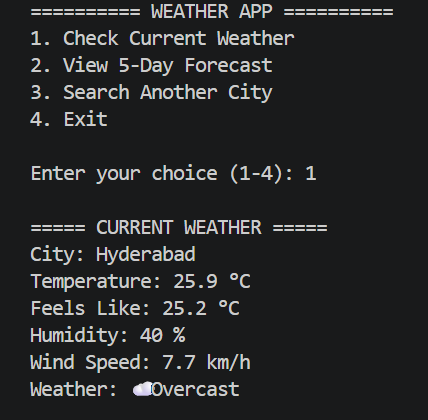

# 🌦️ Python Weather App

A Python-based Weather Application that fetches real-time weather information and provides a 5-day weather forecast for different cities using the **Open-Meteo API**.

## 🚀 Features

- Search weather information for different cities.
- Get current weather details.
- View a 5-day weather forecast.
- Fetch weather data using the Open-Meteo API.

## 🛠️ Technologies Used

- Python
- Requests Library
- Open-Meteo API

## 📁 Project Structure

```text
python-weather-app/
│
├── README.md
└── weather.py
```

## ⚙️ Installation and Setup

**1. Clone the repository**

```bash
git clone https://github.com/santoshpradhan90061/python-weather-app.git
```

**2. Open the project folder**

```bash
cd python-weather-app
```

**3. Install the required library**

```bash
pip install requests
```

**4. Run the application**

```bash
python weather.py
```

## 🌐 API Used

[Open-Meteo API](https://open-meteo.com/)

Open-Meteo provides weather forecast data through its API.

## 📸 Screenshots




## 👨‍💻 Author

**Santosh Pradhan**

- GitHub: [santoshpradhan90061](https://github.com/santoshpradhan90061)
- Portfolio: [My Portfolio](https://santoshpradhan90061.github.io/santosh-portfolio/)

## 📄 License

This project is created for learning and educational purposes.